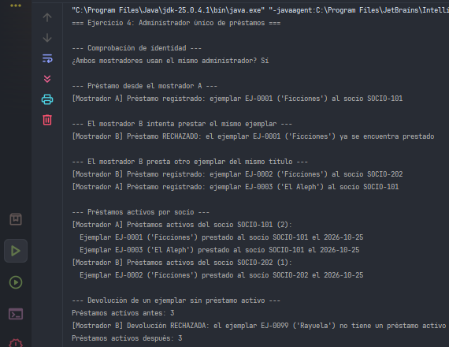
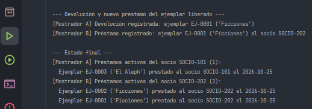

# Ejercicio 04 - Administrador Único de Préstamos

## Descripción

Dos mostradores de una biblioteca registran préstamos desde una misma aplicación. Al utilizar administradores independientes, ambos podían prestar el mismo ejemplar físico a socios diferentes. Este ejercicio centraliza el estado de los préstamos en un único administrador y aplica las reglas de negocio sobre cada ejemplar.

## Objetivos

- Utilizar Singleton para mantener un estado compartido y aplicar reglas de negocio sobre un recurso identificado individualmente.
- Registrar préstamos con el identificador del ejemplar, el socio y la fecha.
- Impedir el préstamo de un ejemplar que ya está prestado.
- Registrar devoluciones para habilitar nuevamente el ejemplar y consultar los préstamos activos de un socio.
- Rechazar la devolución de un ejemplar sin préstamo activo, sin modificar el estado.
- Demostrar que un préstamo hecho en un mostrador impide prestar el mismo ejemplar desde el otro.

## Implementación del patrón Singleton

Se utiliza la variante **enum Singleton**:

- `LoanManager` es un `enum` con un único valor, `INSTANCE`.
- La JVM garantiza una única instancia del enum y protege su identidad frente a los mecanismos habituales de reflexión y serialización.
- Los mostradores acceden mediante `LoanManager.INSTANCE`.

## Propósito de las clases

- `LoanManager`: es el Singleton. Mantiene los préstamos activos indexados por identificador de ejemplar y aplica las reglas de negocio: no prestar dos veces el mismo ejemplar ni devolver uno que no está prestado.
- `BookCopy`: representa un ejemplar físico con un identificador propio, aunque comparta título con otros ejemplares.
- `Loan`: representa un préstamo activo e incluye el ejemplar, el socio y la fecha.
- `LibraryCounter`: representa un mostrador, utiliza el administrador compartido e informa los resultados por consola.
- `Main`: demuestra el rechazo del doble préstamo, la devolución inválida y la reutilización del ejemplar liberado.

## Concepto clave

El Singleton centraliza un **estado compartido** sobre el que se aplican **reglas de negocio**. Como el recurso es cada ejemplar físico, el estado se indexa por su identificador. Dos ejemplares del mismo título son recursos distintos y pueden prestarse al mismo tiempo, pero un mismo ejemplar no puede tener dos préstamos activos.

## Resultado

## Conclusión

Con un único administrador, un préstamo registrado en un mostrador es visible de inmediato para el otro, lo que evita prestar el mismo ejemplar dos veces. 
Rechazar operaciones inválidas sin alterar el estado mantiene la consistencia de los datos.